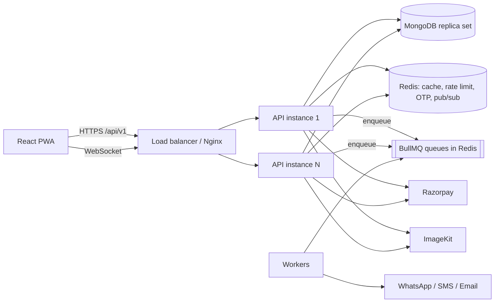

# Jail Ki Chai — Cafe Platform

Food ordering + table booking + party booking + admin/staff/rider panels for the cafe **Jail Ki Chai**, built to scale to 1 Cr+ registered users.

> **Status:** Phase 0–7 complete (customer app + staff/admin console). See [Roadmap](#roadmap).

## Features (target)

- **Food ordering**: menu with categories, veg/non-veg, add-ons, variants; cart; coupons; pincode/distance delivery charge; live tracking.
- **Table booking**: date / slot / guests, concurrency-safe capacity, optional deposit, reminders.
- **Party booking**: packages, inquiry → admin quote → accept → token payment → confirmed.
- **Panels**: admin, staff, rider (RBAC: `customer | admin | staff | rider`).

## Architecture



Request flow: `route → validator → middleware → controller → service → model/integration`. Controllers are thin; all business logic is in services; services never touch `req/res`.

## Tech stack

Backend: Node.js 20+, Express 4, MongoDB (Mongoose), Redis (ioredis), BullMQ, Socket.io, Zod, JWT, Razorpay, ImageKit, Pino, Helmet, express-rate-limit (Redis store), Jest + Supertest.
Frontend (Phase 4): React + Vite, Tailwind, React Router, TanStack Query, Zustand, GSAP, Lenis, PWA.
DevOps: Docker, docker-compose, PM2 cluster, GitHub Actions, ESLint + Prettier + Husky + lint-staged.

> Express 4 is deliberate: `express-mongo-sanitize` is not compatible with Express 5's read-only `req.query`.

## Folder structure

```
backend/   src/{config,models,routes,controllers,services,repositories,middlewares,validators,jobs,sockets,utils,integrations,docs}, tests/
frontend/  src/{app,components/{ui,common,animations},features/{auth,menu,cart,orders,profile,notifications,ui},hooks,lib,pages,styles}, e2e/, scripts/
docs/      db.md, environment.md, scaling.md
docker-compose.yml   .github/workflows/ci.yml
```

## Prerequisites

Node 20+ (22 recommended), MongoDB 6+/7 **as a replica set** (transactions), Redis 6+, Docker (optional).

## Setup

### Docker (everything)

```bash
docker compose up --build        # api :5000, mongo :27017 (replica set rs0), redis :6379
curl localhost:5000/ready
```

### Local

```bash
npm install                      # root: husky + lint-staged + prettier
cd backend && npm install
cp .env.example .env             # fill MONGO_URI, REDIS_URL, JWT secrets (see docs/environment.md)
npm run dev
```

Infra only: `docker compose up mongo redis`, then use `MONGO_URI=mongodb://localhost:27017/?replicaSet=rs0` and `REDIS_URL=redis://localhost:6379`.

## Scripts (backend)

| Script                      | What it does                           |
| --------------------------- | -------------------------------------- |
| `npm run dev`               | Start with `node --watch`              |
| `npm start`                 | Production start (single process)      |
| `npm run start:pm2`         | PM2 cluster via `ecosystem.config.cjs` |
| `npm run lint` / `lint:fix` | ESLint                                 |
| `npm test`                  | Jest + Supertest                       |

Seed (`npm run seed`) and the frontend scripts arrive in later phases.

## API

- Swagger UI: `http://localhost:5000/api/docs` (JSON: `/api/docs.json`)
- Auth: `POST /auth/otp/request` → `/auth/otp/verify` (access token in body, rotating refresh token in an httpOnly cookie) · `/auth/refresh` · `/auth/logout` · `/auth/login` (admin/staff/rider email+password)
- `GET/PATCH /users/me`, `PUT /users/me/avatar`; admin: `GET/POST /users`, `PATCH /users/:id/role|status`
- `/addresses` CRUD + `PUT /addresses/:id/default`; `GET /uploads/auth` (ImageKit signature)
- Catalog (public, cached): `GET /categories`, `GET /menu-items?category&veg&available&q`, `GET /menu-items/:idOrSlug`, `GET /banners?position`, `GET /delivery-zones`, `POST /delivery-zones/quote`, `GET /coupons`; `POST /coupons/validate` (auth). Admin/staff write endpoints and `/…/manage` lists are documented in Swagger. **All prices are integer paise.**
- Cart `/cart…` (server-priced, atomic) · `POST /orders/preview`, `POST /orders` (**requires `Idempotency-Key`**), `GET /orders`, `POST /orders/:id/cancel` · staff `GET /orders/manage`, `PATCH /orders/:id/status|assign` · rider `GET /orders/rider/mine`
- Payments: `POST /payments/razorpay/order` → Razorpay Checkout → `POST /payments/razorpay/verify`; `POST /payments/razorpay/webhook` (signature + idempotency). COD supported.
- `GET /notifications`, `/notifications/unread-count`, `POST /notifications/read`
- Table booking: `GET /booking-slots/availability?date=` (live seats) · `POST /table-bookings` (**requires `Idempotency-Key`**; seats are taken atomically, deposit slots are HELD 10 min until paid via `POST /table-bookings/:id/pay` + `/payments/razorpay/verify`) · `GET /table-bookings`, `POST /table-bookings/:id/cancel` · staff: `GET /table-bookings/manage[?date=]`, `/manage/calendar?month=`, `PATCH /:id/outcome`; admin slot CRUD under `/booking-slots`
- Party booking: `GET /party-packages` · `POST /party-inquiries` (**requires `Idempotency-Key`**) → staff `PATCH /party-inquiries/:id/quote` → customer `POST /:id/accept` (reserves the date atomically) → `POST /:id/pay` + `/payments/razorpay/verify` (token) → `CONFIRMED`; also `/decline`, `/cancel`, staff `/close`, `/complete`, inbox `GET /party-inquiries/manage`
- Admin: `GET /admin/analytics/dashboard?days=` · `GET|PUT /admin/settings` (+ public `GET /settings`) · reviews `POST /reviews`, `GET /reviews`, `/reviews/summary`, admin `PATCH /reviews/:id/status`
- **Realtime (Socket.io, same origin as the API)** – connect with `auth: { token: <access token> }`. Client → server: `order:subscribe {orderId}` (ack returns status + last rider location), `rider:location {orderId,lat,lng}` (riders). Server → client: `order:new` (staff room; play the alert sound), `order:status`, `order:payment`, `order:location`, `notification:new`.
- Probes: `GET /health` (liveness), `GET /ready` (Mongo + Redis; 503 while shutting down)
- Response envelope: `{ success, message, data, meta }`; errors: `{ success:false, message, code, details, requestId }`

## Testing

`cd backend && npm test` (~420 tests: unit, integration, concurrency, index/explain audit, security matrix, API-docs parity). Frontend: `cd frontend && npm test` (Vitest) and the Playwright scripts in `frontend/e2e`. Load test: `node backend/scripts/loadtest.mjs` (results in docs/scaling.md). Integration tests start an in-memory MongoDB **replica set** via `mongodb-memory-server` (first run downloads a `mongod` binary; set `MONGOMS_SYSTEM_BINARY=/path/to/mongod` to use a local one) and a fake Redis. The BullMQ suite (`tests/integration/queue.test.js`) needs a real Redis: it runs when `CI=true` or `RUN_REDIS_TESTS=1` (uses `REDIS_TEST_URL`, default `redis://127.0.0.1:6379`) and is skipped otherwise.

## Deployment

Prerequisites everywhere: MongoDB **replica set** (Atlas works), Redis with `noeviction` and persistence, ImageKit, Razorpay (webhook configured), an SMS provider. Variables: [docs/environment.md](docs/environment.md).

**VPS (Docker + Nginx)**

1. `cp backend/.env.example backend/.env` and fill production values (https `CLIENT_URLS`, strong secrets, `TRUST_PROXY=1`).
2. `docker compose up -d --build` (api, web, mongo, redis). For production prefer managed Mongo/Redis and remove those services.
3. Run one worker process per deployment: `node src/worker.js` (or `pm2` app `jkc-worker`) so BullMQ jobs run; the API container does not need to run them when scaled out.
4. Seed once: `SEED_ADMIN_PASSWORD=… npm run seed` then unset the variable.
5. Nginx in front (TLS via certbot). Sample:

```nginx
server {
  listen 443 ssl http2; server_name api.example.com;
  location / {
    proxy_pass http://127.0.0.1:5000;
    proxy_set_header Host $host;
    proxy_set_header X-Forwarded-For $proxy_add_x_forwarded_for;
    proxy_set_header X-Forwarded-Proto $scheme;
    proxy_http_version 1.1;                      # Socket.io websockets
    proxy_set_header Upgrade $http_upgrade;
    proxy_set_header Connection "upgrade";
    client_max_body_size 1m;
  }
}
```

With several API replicas use `ip_hash` (or sticky cookies) for Socket.io; the Redis adapter handles fan-out between them.

**Render / Railway (API)**: Docker web service from `backend/`, health check `/health`, plus a second "background worker" service with command `node src/worker.js`. Add the env vars from `docs/environment.md`.

**Vercel / Netlify (frontend)**: root `frontend/`, build `npm run build`, output `dist`, set the `VITE_*` variables. `frontend/vercel.json` adds SPA rewrites, security headers and immutable asset caching. On Netlify add the equivalent `_redirects` (`/* /index.html 200`). Alternatively use the `frontend/Dockerfile` (unprivileged nginx on :8080; edit the CSP `connect-src`/`img-src` in `frontend/nginx.conf`).

**Monitoring**: set `METRICS_TOKEN` and scrape `/metrics` with Prometheus (bearer token); set `SENTRY_DSN` (and `npm i @sentry/node`) for error tracking. Pino JSON logs go to stdout; ship them with your platform.

Production checklist: [docs/environment.md](docs/environment.md#production-checklist). Security controls and audit: [docs/security.md](docs/security.md).

## Scaling

See [docs/scaling.md](docs/scaling.md) and [docs/db.md](docs/db.md).

## Contributing / code style

Prettier + ESLint enforced by a Husky pre-commit (lint-staged). Enums/constants live in `utils/constants.js`. JSDoc on service methods. No business logic in controllers. Conventional, descriptive commits.

## Troubleshooting

| Symptom                                            | Fix                                                                            |
| -------------------------------------------------- | ------------------------------------------------------------------------------ |
| App exits with `Invalid environment configuration` | Fill the listed vars in `backend/.env`                                         |
| `/ready` returns 503                               | Check `data.checks` to see whether `mongo` or `redis` is down                  |
| Mongo transactions error `replica set`             | Run Mongo as a replica set (`--replSet rs0`, `rs.initiate`); compose does this |
| CORS blocked in browser                            | Add the exact origin (no trailing slash) to `CLIENT_URLS`                      |

## Roadmap

- [x] **Phase 0** scaffold, config, errors, logging, probes, Docker, CI
- [x] **Phase 1** auth (OTP, JWT rotation + reuse detection, RBAC), users, addresses, ImageKit uploads
- [x] **Phase 2** categories, menu items (variants/add-ons/stock toggle), banners, delivery zones, coupons + versioned Redis cache
- [x] **Phase 4** frontend foundation: design system, Lenis + GSAP, layouts, OTP auth, menu, cart (guest + server, optimistic), checkout + Razorpay, live order tracking, PWA
- [x] **Phase 5** table booking: slot inventory with atomic seat counters (no double booking), optional refundable deposit with auto-expiring holds, reminders, cancellation rules, booking calendar API; frontend booking flow
- [x] **Phase 6** party booking: packages, inquiry → quote → accept (atomic date reservation) → token payment → confirmed, status timeline, expiry jobs; frontend
- [x] **Phase 7** admin/staff console: live orders board with sound alert, menu manager (stock toggle + ImageKit upload), bookings calendar + slots, party inbox + quotes + packages, coupons, banners, users, reviews, settings (open/closed switch), dashboard with rollup-backed charts and counters
- [x] **Phase 8** hardening: index/explain audit, security + access-control matrix tests, Prometheus metrics, error tracking hook, load test, security and deployment docs
