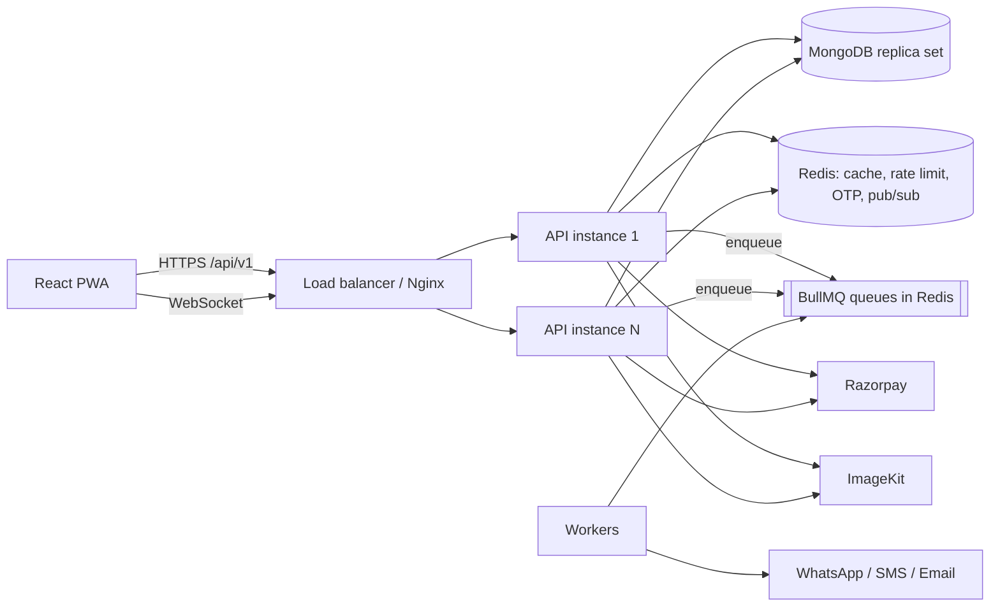

# Jail Ki Chai — Cafe Platform

Food ordering + table booking + party booking + admin/staff/rider panels for the cafe **Jail Ki Chai**, built to scale to 1 Cr+ registered users.

> **Status:** Phase 0–1 complete (scaffold + auth/users/addresses/uploads). See [Roadmap](#roadmap).

## Features (target)

- **Food ordering**: menu with categories, veg/non-veg, add-ons, variants; cart; coupons; pincode/distance delivery charge; live tracking.
- **Table booking**: date / slot / guests, concurrency-safe capacity, optional deposit, reminders.
- **Party booking**: packages, inquiry → admin quote → accept → token payment → confirmed.
- **Panels**: admin, staff, rider (RBAC: `customer | admin | staff | rider`).

## Architecture



Request flow: `route → validator → middleware → controller → service → model/integration`. Controllers are thin; all business logic is in services; services never touch `req/res`.

## Tech stack

Backend: Node.js 20+, Express 4, MongoDB (Mongoose), Redis (ioredis), BullMQ, Socket.io, Zod, JWT, Razorpay, ImageKit, Pino, Helmet, express-rate-limit (Redis store), Jest + Supertest.
Frontend (Phase 4): React + Vite, Tailwind, React Router, TanStack Query, Zustand, GSAP, Lenis, PWA.
DevOps: Docker, docker-compose, PM2 cluster, GitHub Actions, ESLint + Prettier + Husky + lint-staged.

> Express 4 is deliberate: `express-mongo-sanitize` is not compatible with Express 5's read-only `req.query`.

## Folder structure

```
backend/   src/{config,models,routes,controllers,services,repositories,middlewares,validators,jobs,sockets,utils,integrations,docs}, tests/
frontend/  (Phase 4)
docs/      db.md, environment.md, scaling.md
docker-compose.yml   .github/workflows/ci.yml
```

## Prerequisites

Node 20+ (22 recommended), MongoDB 6+/7 **as a replica set** (transactions), Redis 6+, Docker (optional).

## Setup

### Docker (everything)

```bash
docker compose up --build        # api :5000, mongo :27017 (replica set rs0), redis :6379
curl localhost:5000/ready
```

### Local

```bash
npm install                      # root: husky + lint-staged + prettier
cd backend && npm install
cp .env.example .env             # fill MONGO_URI, REDIS_URL, JWT secrets (see docs/environment.md)
npm run dev
```

Infra only: `docker compose up mongo redis`, then use `MONGO_URI=mongodb://localhost:27017/?replicaSet=rs0` and `REDIS_URL=redis://localhost:6379`.

## Scripts (backend)

| Script                      | What it does                           |
| --------------------------- | -------------------------------------- |
| `npm run dev`               | Start with `node --watch`              |
| `npm start`                 | Production start (single process)      |
| `npm run start:pm2`         | PM2 cluster via `ecosystem.config.cjs` |
| `npm run lint` / `lint:fix` | ESLint                                 |
| `npm test`                  | Jest + Supertest                       |

Seed (`npm run seed`) and the frontend scripts arrive in later phases.

## API

- Swagger UI: `http://localhost:5000/api/docs` (JSON: `/api/docs.json`)
- Auth: `POST /auth/otp/request` → `/auth/otp/verify` (access token in body, rotating refresh token in an httpOnly cookie) · `/auth/refresh` · `/auth/logout` · `/auth/login` (admin/staff/rider email+password)
- `GET/PATCH /users/me`, `PUT /users/me/avatar`; admin: `GET/POST /users`, `PATCH /users/:id/role|status`
- `/addresses` CRUD + `PUT /addresses/:id/default`; `GET /uploads/auth` (ImageKit signature)
- Probes: `GET /health` (liveness), `GET /ready` (Mongo + Redis; 503 while shutting down)
- Response envelope: `{ success, message, data, meta }`; errors: `{ success:false, message, code, details, requestId }`

## Testing

`cd backend && npm test`. Integration tests start an in-memory MongoDB **replica set** via `mongodb-memory-server` (first run downloads a `mongod` binary; set `MONGOMS_SYSTEM_BINARY=/path/to/mongod` to use a local one) and a fake Redis, so no services are required.

## Deployment (summary)

- **VPS**: Docker compose or PM2 behind Nginx with sticky sessions for Socket.io; managed MongoDB Atlas + Redis.
- **Render/Railway**: deploy `backend/` as a Docker web service, set env vars from `docs/environment.md`.
- **Vercel/Netlify**: frontend (Phase 4).
  Full checklist: [docs/environment.md](docs/environment.md#production-checklist).

## Scaling

See [docs/scaling.md](docs/scaling.md) and [docs/db.md](docs/db.md).

## Contributing / code style

Prettier + ESLint enforced by a Husky pre-commit (lint-staged). Enums/constants live in `utils/constants.js`. JSDoc on service methods. No business logic in controllers. Conventional, descriptive commits.

## Troubleshooting

| Symptom                                            | Fix                                                                            |
| -------------------------------------------------- | ------------------------------------------------------------------------------ |
| App exits with `Invalid environment configuration` | Fill the listed vars in `backend/.env`                                         |
| `/ready` returns 503                               | Check `data.checks` to see whether `mongo` or `redis` is down                  |
| Mongo transactions error `replica set`             | Run Mongo as a replica set (`--replSet rs0`, `rs.initiate`); compose does this |
| CORS blocked in browser                            | Add the exact origin (no trailing slash) to `CLIENT_URLS`                      |

## Roadmap

- [x] **Phase 0** scaffold, config, errors, logging, probes, Docker, CI
- [x] **Phase 1** auth (OTP, JWT rotation + reuse detection, RBAC), users, addresses, ImageKit uploads
- [ ] Phase 2 catalog + caching · Phase 3 cart/orders/payments/realtime
- [ ] Phase 4 frontend foundation · Phase 5 table booking · Phase 6 party booking · Phase 7 admin · Phase 8 perf/security/docs
